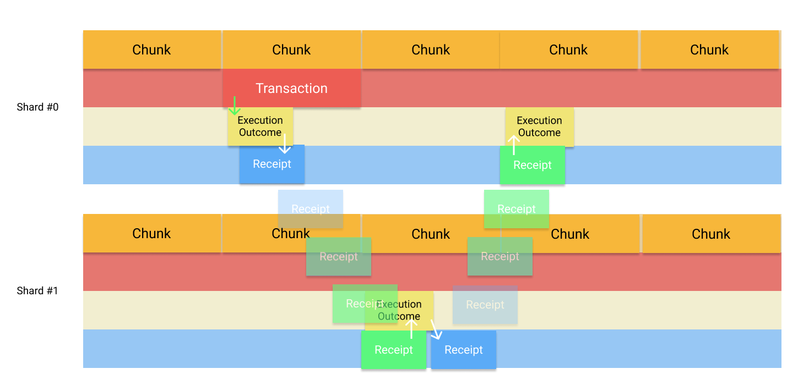

> 研究资料截至 2026 年 10 月 15 日。文中的市场数据和协议状态以各处标注的日期为准。

## 1. 项目概况与它要解决的问题

NEAR 是一条采用权益证明（Proof of Stake，PoS）的通用 Layer 1 区块链，原生代币为 NEAR。两位联合创始人 Illia Polosukhin 和 Alexander Skidanov 都有 AI 研究背景。他们认为，既有区块链基础设施上的支付体验难以使用，因此决定构建一条可扩展的区块链。[^1] NEAR 主网于 2020 年上线，如今生态参与者包括 NEAR Foundation、Near One、独立验证者，以及不断增长的开发者社区。[^2] 回看它的发展历程，有意思的一点是：NEAR 最初的目标很直接，就是提供便宜、快速的智能合约执行环境，随后逐渐将叙事扩展到链抽象和“用户拥有的 AI”（User-Owned AI）。

NEAR 主要试图解决两个问题：易用性与可扩展性。[^1] 对普通用户而言，Bitcoin、Ethereum 等传统区块链往往不够友好：钱包、私钥和交易流程都需要自己管理，使用起来容易感到挫败。它们也面临扩容限制，基础层的吞吐量按设计通常只有每秒几十笔交易，因此在需求高涨时容易拥堵，费用也会上升。

NEAR 从两个方向应对这些问题。Nightshade 将交易处理工作分配到不同的分片（shard），让网络的不同部分能够并行运行。在账户体验上，NEAR 支持人类可读的账户名，以及同一账户下具有不同权限的多把密钥。[^3] [^4] 近来，NEAR Intents 与 Chain Signatures 又进一步简化了跨区块链交易的操作。[^5] [^6]

## 2. 技术架构

| 层级 | 主要组成 | 作用 |
| --- | --- | --- |
| 协议层 | nearcore、账户、访问密钥、签名 | 定义账户、权限和基本协议操作。 |
| 共识层 | 阈值权益证明、按质押权重计算的批准 | 选择生产者并确定区块最终性。 |
| 数据层 | Nightshade、分片、chunk、状态见证 | 将状态和交易处理工作分配到多个分片。 |
| 逻辑层 | WebAssembly 运行时、异步 receipt、回调 | 执行合约并处理跨合约交互。 |
| 应用层 | 钱包、dApp、NEAR Intents、Chain Signatures | 为用户提供链上与跨链服务。 |

### 协议层

NEAR 的协议层围绕 nearcore 构建。nearcore 是使用 Rust 编写的参考客户端，负责点对点网络、密码学签名和基于哈希的状态承诺。[^7] NEAR 账户系统的一项特点，是在代币与智能合约的操作权限上提供了较细的控制。具体来说，它采用账户模型，而不是 Bitcoin 的未花费交易输出（UTXO）模型，并原生支持每个账户配置多把密钥，以及受限的函数调用权限。

一个命名账户可以拥有多把访问密钥。完全访问密钥（full-access key）可以授权广泛的账户操作；函数调用密钥（function-call key）则可以被限制为只能调用特定合约、特定方法，并使用指定的 gas 额度。因此，应用可以请求有限授权，类似软件开发中的细粒度访问令牌，而不必获得转走用户全部资金的能力。这可以限制对应私钥泄露后的损失范围，但攻击者仍可能调用授权范围内的合约函数，或消耗已获准使用的 gas 预算。[^3] [^4]

普通交易签名支持 Ed25519 和 secp256k1。2026 年 7 月 20 日的一次协议升级还引入了 ML-DSA-65，为账户访问密钥与交易提供后量子签名选项。[^8] 它是一项可选能力，并不意味着所有用户都会自动迁移。

更重要的是，这次升级没有改变验证者签名密钥、共识签名，或外部桥的安全假设。因此，更准确的说法是 NEAR 在抗量子攻击的账户安全上取得了进展，而不能据此断言整个 NEAR 系统已经实现了量子安全。[^9]

### 共识层

NEAR 使用一种称为阈值权益证明（Thresholded Proof of Stake，TPoS）的 PoS 机制来维护共识。验证者质押 NEAR，也可以接收其他持币者的委托质押。每个 epoch 都会通过拍卖形成由市场决定的最低席位质押门槛，验证者按照自己的质押比例获得席位。被选中的验证者再按质押权重参与区块与分片 chunk 的生产。[^10]

共识规则要求相关生产者质押权重中超过三分之二的批准，并在连续两个后继区块出现后达到最终性。[^11] 常被引用的 600 毫秒出块时间和约 1.2 秒最终性，描述的是网络预期或报告中的性能。[^12] 如果参与质押中超过三分之一的权重不可用，或停止批准区块，最终确认就会中断，从而产生网络活性风险。[^11]

### 数据层

NEAR 通过开源分片机制 Nightshade 实现扩容。它不要求每个节点处理所有交易，而是把账户及其相关状态分散到多个分片，让交易能够并行处理。每个分片处理自己的交易并产出一个 chunk，区块生产者再将这些 chunk 组织为一个区块。NEAR 在 2020 年上线时只有一个分片，经过 2025 年的更新，主网分片数扩展到九个。[^13]

一个简单的理解方式是：如果两笔互不相关的转账落在不同分片，它们就可以并行处理，而不必在同一个分片中串行执行。当分片 A 上的智能合约需要与分片 B 上的合约交互时，Nightshade 会通过异步 receipt 处理，具体机制将在“逻辑层”部分进一步说明。[^14]

数据层的一次重要升级发生在 2024 年 8 月：Nightshade 2.0 引入了无状态验证（stateless validation）。[^15] 在此前的设计中，区块生产者需要维护所有分片的状态来验证交易。新设计下，chunk 生产者维护其负责分片的状态，并生成状态见证（state witness）。见证包含验证该 chunk 所需的信息，以及证明这些数据与此前已承诺状态一致的密码学证明。其他被分配来验证 chunk 的验证者，可以利用见证独立验证交易与状态变化，而无需自行存储该分片的完整状态。

此外，一个 chunk 必须获得其所属验证质押权重中超过三分之二的背书，才能被纳入区块。这降低了验证者的一部分存储要求，但见证仍需要被创建和传输，网络中的其他节点也仍然需要维护状态。[^16]

除已经实现的功能外，NEAR 公布的路线图还提出通过 SPICE 进一步分离共识与执行。考虑到协议开发推进得很快，这是一个值得继续关注的方向。[^12]

### 逻辑层

NEAR 的逻辑层负责执行交易和智能合约，并更新区块链状态。与在 Ethereum Virtual Machine（EVM）上运行合约的 Ethereum 不同，NEAR 使用 WebAssembly（WASM）运行时。开发者可以使用 Rust、JavaScript 等语言编写合约，再将其编译为 WASM 执行。[^17] 每次合约执行都会消耗 gas，由此产生的账户余额或合约存储变化则被记录到链上状态中。

NEAR 与 Ethereum 的一个重要区别，在于跨合约交互的处理方式。NEAR 不会同步完成所有跨合约调用，而是使用异步 receipt：对另一份合约的调用会被安排在稍后执行，而非立即完成。这与许多编程语言中的异步事件循环有相似之处。

例如，去中心化交易所合约调用代币合约转移资产时，转账可能在后续区块才被执行，甚至可能在原始合约调用已经成功后失败。因此，开发者必须通过回调检查执行结果，并处理失败或退款。这样的设计让不同分片上的合约能够独立、并行运行，但也增加了多合约交易的复杂性，因为这些操作不会自动构成原子事务。[^14]

*跨分片转账示意图，来源：[NEAR 官方文档](https://docs.near.org/protocol/data-flow/token-transfer-flow)。图片未经修改，保留其 [MIT 许可](near-docs-LICENSE-MIT.txt)。*

### 应用层

在应用层，用户通过钱包与去中心化应用（dApp）使用 NEAR，包括去中心化交易所（DEX）、游戏和跨链服务。这些应用依赖 NEAR 的底层基础设施执行智能合约、管理资产。除了直接部署在 NEAR 上的应用，生态还提供了与其他区块链交互的工具。其中，NEAR Intents 与 Chain Signatures 是两个重要组件，分别尝试简化跨链交易和账户管理。[^5] [^6]

NEAR Intents 允许用户直接表达期望的结果，而不必逐步安排交易如何执行。例如，一个持有 Ethereum 上 ETH 的用户，可能希望换到 Solana 上的 SOL。用户可以提交一项描述换币目标的请求，再由被称为 solver 的独立服务提供方竞争履约：它们寻找执行路径并提供流动性。借助 NEAR Intents，用户不必亲自执行各个中间步骤。跨链交易因此变得更简单，但也引入了桥、solver 流动性和外部网络相关的风险。[^5]

Chain Signatures 解决的是跨链问题的另一面。它通过多方计算（MPC），让 NEAR 账户或应用能够授权受支持外部网络上的交易，而不必要求用户为每个网络分别管理私钥。换句话说，NEAR 账户可以通过 MPC 网络共同生成交易签名，控制在 Ethereum 等受支持区块链上新派生出的地址。

不过，它不能控制任意已有钱包地址，因为这些地址对应的是 MPC 网络并不持有的其他私钥。它也不是由某一方掌握完整签名密钥，而是将签名过程分散到多个 MPC 参与者之间。与此同时，这带来了独立的安全依赖：MPC 网络拥有自己的运营者与签名阈值，并不等同于 NEAR Layer 1 的共识安全。[^6]

## 3. 代币经济：供应、分配与激励

### 3.1 供应与初始分配

NEAR 在 2020 年 4 月创世时发行了 **10 亿枚代币**，初始分配如下。[^18]

| 分配对象 | 占创世供应量的比例 |
| --- | ---: |
| 早期投资者 | 23.7% |
| 核心贡献者 | 14.0% |
| 社区资助与计划 | 17.2% |
| 社区销售 | 12.0% |
| 早期生态发展 | 11.7% |
| 运营资助 | 11.4% |
| NEAR Foundation 储备基金 | 10.0% |
| **合计** | **100.0%** |

大部分创世代币设有锁定期，限制获得分配的参与者立即转让或出售代币。核心贡献者的锁定安排为四年，其中前 12 个月设有 cliff：第一年无法转让，满 12 个月时约 25% 的代币变得可转让，其余部分在随后的三年逐步释放。早期投资者的锁定期为 12 至 36 个月，社区与运营资助的释放安排则最长延伸到 60 个月。因此，NEAR 的创世分配代币在 2025 年 10 月已全部解锁。[^18]

截至 2026 年 10 月 13 日，NEAR 总供应量约为 13.09 亿枚，市场价格接近 5 美元，市值约为 65 亿美元。[^19] 与 Bitcoin 不同，NEAR 没有固定的供应上限。初始锁定安排结束后，未来供应变化主要取决于持续发行和交易手续费销毁，而不再是创世代币的解锁。[^20]

### 3.2 新增发行与质押激励

NEAR 采用阈值权益证明，验证者通过质押 NEAR 参与区块生产与验证，奖励来自新发行的代币。NEAR 最初的最高年发行率为 5%，在 2025 年末降至 2.5%。[^21] 新发行的代币中，90% 分配给质押参与者，剩余 10% 进入协议金库。[^20] [^22] 以 2026 年 10 月约 13.09 亿枚的总供应量计算，2.5% 的年发行上限相当于每年新增约 3,270 万枚 NEAR。这种发行机制为网络安全提供激励，同时也会稀释不参与质押的持币者。

为了抵消新增发行，NEAR 会销毁交易手续费，将代币永久移出流通。用户进行转账或执行智能合约时，需要以 NEAR 支付 gas。原有费用模型下，基础交易手续费全部销毁；用于智能合约函数执行的 gas 则按 70% 销毁、30% 计入合约账户作为奖励的方式分配。因此，NEAR 的净供应增长，取决于新增发行与交易销毁之间的差额。[^23]

2026 年 7 月，NEAR 治理通过了 HSP-027，提议取消 30% 的开发者奖励，改为将执行 gas 费用全部销毁。[^24] 截至本文写作时，该变更已在代码库中实现，但尚未在主网激活。[^7] 这一调整会提高费用销毁比例，并降低净供应量。另一方面，将年发行率进一步降至 1.6% 的方案也处于讨论之中。[^22] 两项措施都旨在降低代币通胀，但更低的发行率也意味着验证者可获得的奖励会减少。

### 3.3 代币的用途

NEAR 在网络中承担多种功能。用户在转移资产或执行智能合约时，用 NEAR 支付 gas；验证者和委托者则通过质押 NEAR 参与网络安全，并获得奖励。[^20]

NEAR 还有存储质押（storage staking）机制：占用网络的共享状态，需要预留一定的 NEAR。账户与应用必须维持与链上存储数据量成比例的最低余额。当前标准为每 100 KB 对应 1 NEAR，因此，一份存储 100 KB 数据的智能合约，除了账户与合约代码本身的存储需求外，还必须预留约 1 NEAR。

这笔代币仍留在合约账户中，只是在数据存续期间被有效锁定，无法转移或支出。它与手续费不同，不会被花掉或销毁；当数据被删除后，对应的 NEAR 会重新变得可用。[^25]

NEAR 也通过 House of Stake 参与治理。持币者可以锁定 NEAR，获得不可转让的 veNEAR 投票权，再选择自己投票或委托代表参与治理决策。[^26]

## 4. 价值捕获与收入流向

NEAR 主要通过两种机制捕获经济价值：Layer 1 的交易手续费销毁，以及由 NEAR Intents 收入支持的代币回购。两者的作用不同：销毁永久减少供应，回购则对现有代币形成需求，但不会自动销毁代币。[^23] [^27]

| 机制 | 资金来源 | 对 NEAR 的影响 |
| --- | --- | --- |
| L1 手续费销毁 | 交易 gas 费用 | 将代币永久从供应中移除。 |
| Intents 回购 | 跨链兑换中捕获的协议收入 | 购入已有代币；持有回购代币不会降低总供应量。 |

### 4.1 Layer 1 交易手续费

用户在转移资产或执行智能合约时，以 NEAR 支付 gas。如第 3.2 节所述，大部分相关执行费用会按 70% 的比例销毁，从而抵消一部分作为质押奖励新发行的代币。然而，NEAR 的低交易成本也限制了手续费对代币的价值捕获：即使链上活动很多，被销毁 gas 所代表的经济价值仍相对有限。

截至 2026 年 10 月 14 日，DefiLlama 统计的此前 30 天 L1 gas 费用约为 19.4 万美元。[^28] 若按每枚 NEAR 约 5 美元计算，相当于约 3.88 万枚 NEAR 的总费用；同期潜在新增发行则约为 269 万枚。即便所有 gas 费用都被销毁，也只能抵消约 1.4% 的新增发行。因此，NEAR 当前 L1 活动产生的手续费收入，还不足以显著降低代币通胀。

### 4.2 NEAR Intents 收入与代币回购

NEAR Intents 位于应用层，通过跨链兑换产生协议费用，并与分发合作伙伴分享费用。根据 DefiLlama 的数据，截至 2026 年 10 月中旬的 30 天内，NEAR Intents 处理了约 48.1 亿美元的兑换量，产生约 818 万美元的总费用。其中，约 228 万美元，也就是约 28%，被 NEAR 捕获为协议收入。[^27]

2026 年 2 月，NEAR 推出了回购计划，使用 Intents 收入在公开市场购买 NEAR，从而为代币创造间接需求。[^27] 报告中的 228 万美元 30 天协议收入，大致相当于同期预计发行代币价值的 17%。与手续费销毁不同，回购获得的 NEAR 被持有，而不是被销毁，因此回购不会减少代币总供应量。[^27]

### 4.3 如何理解 NEAR 的价值

#### 劳动与网络安全

与 Ethereum 类似，NEAR 通过 PoS 让验证者质押代币、为网络提供服务。这些验证者运行节点、检查交易与状态变化、参与共识，防止双花，并维护可靠、去中心化的账本。他们的报酬主要来自新增发行的 NEAR。[^20] 不过，这些奖励并不直接衡量他们创造的经济价值，因为发行本身也会增加总供应，并对现有持币者形成稀释。

#### 货币供应与收入

NEAR 的货币价值受到发行与需求之间平衡的影响。新增发行增加总供应，gas 销毁则永久移除代币。Intents 产生的收入可以通过公开市场回购间接创造需求，但不会减少总供应。[^23] [^27] 如第 4.1、4.2 节所述，目前手续费销毁相对于发行量仍然很小，而 Intents 提供了较大规模、由收入支持的代币需求。

总体而言，NEAR 的经济可持续性，取决于网络活动的增长能否产生足够的手续费和回购需求，以对照持续新增的发行量。此外，也值得继续关注降低年发行率的讨论，以及它将如何改变 NEAR 代币的供需关系。

#### 实用性与主观价值

NEAR 有多种实际用途，包括支付 gas、存储质押和验证者质押。[^20] [^25] 不过，它的市场价值也取决于人们如何理解其用途与未来潜力。例如，NEAR Intents 让跨链交易简单了许多，而用户甚至不需要持有 NEAR。[^5] 此外，当 NEAR 将自己定位于“用户拥有的 AI”与 AI 应用时，人们也可能更多根据这些预期，而非已经交付的功能来判断它的价值。

#### 权力与治理

NEAR 的经济政策受到治理权力分布的影响。通过 House of Stake，持币者可以锁定 NEAR 获得 veNEAR 投票权，锁定时间越长，影响力越大。[^26] 但一个值得担忧的问题是：当前治理权力过于集中。截至 2026 年 10 月，最大的十个钱包控制了约 81% 的 veNEAR 投票权，仅五名代表合计就拥有形成简单多数所需的票数。[^29]

这种集中度会产生经济后果。例如，House of Stake 在 2026 年 7 月通过 HSP-027，提议取消 30% 的开发者 gas 返还，并在实施后把这部分费用用于销毁。[^24] 这相当于把经济利益从智能合约开发者转移到降低代币通胀的方向。与 Bitcoin、Ethereum 类似，单靠治理投票并不能改变 NEAR 协议，仍然需要验证者采用升级。[^24] [^7]

## 5. 去中心化与安全

### 5.1 去中心化

除了 NEAR 协议本身的去中心化设计，还需要关注两个问题：验证者和投票权是否足够分散。如第 4.3 节所述，当前治理权力高度集中，最大的十个钱包控制着约 81% 的 veNEAR 投票权。[^29]

验证者的分布相对好一些，但仍然值得关注。截至 2026 年 10 月 13 日，NEAR 有 409 个活跃验证者，最大的九个验证者池控制了总质押量的 35.53%。[^30] 由于区块最终确认需要相关质押权重中超过三分之二的批准，这九个验证者池如果协调行动，就可能引发链的活性问题。[^11] 第 6 节将进一步讨论这种情况为何会发生。

### 5.2 安全事件

2026 年 10 月 1 日披露的一起涉及 HOT Omni Bridge 与 NEAR Intents 的攻击，造成了约 380 万美元的未授权提款。漏洞位于应用层 NEAR Intents 的退款流程中：一笔存款先通过 Intents 智能合约被计入余额，后续操作失败时，底层资产被退回，但此前计入的余额却没有冲销。

由于 NEAR 的跨合约调用是异步的，后续失败不会自动回滚已经成功的前序操作，攻击者因此能够利用错误保留的余额提款。[^31] 这次事件没有破坏 NEAR Layer 1 的共识，Intents 团队还表示，所有被盗资金在 10 月 2 日前已经归还。[^32] 不过，它说明了：即使底层区块链依然安全，跨合约执行和桥接集成中的失败处理，也可能使用户资金暴露在风险之中。

## 6. 个人判断

总体上，我对 NEAR 比较乐观。它选择在协议层解决问题，并且把易用性放在优先位置，而易用性正是推动采用的重要因素。团队的交付速度也很快：2.13 版本在 7 月上线，带来了动态分片重组与 ML-DSA 签名。[^8] 对 AI agent 的关注，也符合当前行业的发展方向。

有意思的是，即使 NEAR 使用了试图缓解集中化问题的阈值权益证明，验证者集中现象仍然存在。PoS 的硬件门槛不算特别高：chunk 验证者的推荐配置是 16 GB 内存和 2 TB NVMe 硬盘。[^33] 但大多数人仍会将质押委托给少数知名运营者，不少运营者也会租用云服务器，而非自行购买硬件。Google Cloud 自己就提到，有一些 NEAR 验证者运行在它的平台上；[^1] 最大的十一个验证者合计持有超过三分之一的质押权重。[^30] AI 热潮推高内存和存储价格，也只会进一步推动运营者向大型云服务商租用资源。

相比通胀，我更担心治理。最高发行率在 2.9.0 升级中从 5% 降到了 2.5%，但部分验证者对变更引入的方式并不满意。[^21] [^34] 大约 44%–47% 的 NEAR 总供应量被质押给验证者，意味着相当一部分代币不能立即进入交易市场。存储质押还会锁定额外的一部分代币，不过我没有找到可靠的规模数据。

质押不会消除通胀或稀释，而且这些代币最终也可以被提取。但随时能够流入市场的 NEAR，确实少于总供应量给人的直观印象。对我而言，更值得担心的是治理权力的集中，尤其是它会如何影响未来代币发行的决策。

至于最薄弱的环节，协议本身看起来已有较多安全保障。ML-DSA 已经在主网上线，nearcore 也有 HackenProof 漏洞赏金计划，对严重漏洞最高支付 100 万美元。[^9] [^35] 共识密钥尚未实现后量子安全，路线图的目标时间是 2027 年。[^9]

我的判断是，更薄弱的地方可能在钱包、SDK 和跨链集成等第三方依赖。HackenProof 上的协议赏金范围只覆盖 nearcore，而 Intents SDK 属于另一个独立计划，最高赏金也低得多。[^35] [^36] 如何在保持易用性的同时，限制用户暴露于 NEAR 无法直接控制的代码，是一个很难平衡的问题。

*封面图片来自 [NEAR 官方文档](https://github.com/near/docs/blob/00c5e33370fe67c4786329c03b1df8009de4a5e5/assets/docs/welcome-pages/1.near-protocol.webp)，保留其 [MIT 许可](near-docs-LICENSE-MIT.txt)。*

## 参考资料

[^1]: Google Cloud. [NEAR: Growing Web3 Adoption Through Usability](https://cloud.google.com/blog/topics/startups/near-building-useable-web3-infrastructure-on-google-cloud). March 20, 2023. Accessed October 15, 2026.
[^2]: NEAR. [The History of NEAR Protocol](https://www.near.org/roadmap-history). Accessed October 15, 2026.
[^3]: NEAR Docs. [Account Model](https://docs.near.org/protocol/accounts-contracts/account-model). Accessed October 15, 2026.
[^4]: NEAR Docs. [Access Keys](https://docs.near.org/protocol/accounts-contracts/access-keys). Accessed October 15, 2026.
[^5]: NEAR Docs. [NEAR Intents: Overview](https://docs.near.org/chain-abstraction/intents/overview). Accessed October 15, 2026.
[^6]: NEAR Docs. [Chain Signatures](https://docs.near.org/chain-abstraction/chain-signatures). Accessed October 15, 2026.
[^7]: NEAR / nearcore. [Release Notes](https://github.com/near/nearcore/releases). Consulted for versions 2.13 and 2.14. The October 14, 2026 release 2.14.0-rc.4 is marked as a testnet pre-release; 2.14.0-rc.1 includes removal of the developer gas reward. Accessed October 15, 2026.
[^8]: NEAR, via PR Newswire. [NEAR Protocol Brings Quantum-Safe Signing to Mainnet](https://www.prnewswire.co.uk/news-releases/near-protocol-brings-quantum-safe-signing-to-mainnet-302829647.html). July 20, 2026. Accessed October 15, 2026.
[^9]: NEAR. [Quantum-Safe NEAR: The Roadmap to Post-Quantum Security](https://near.org/blog/near-quantum-safe-roadmap). August 24, 2026. Accessed October 15, 2026.
[^10]: NEAR Docs. [Validators](https://docs.near.org/protocol/network/validators). Accessed October 15, 2026.
[^11]: NEAR Nomicon. [Consensus](https://nomicon.io/ChainSpec/Consensus). The approval threshold is defined using the relevant block-producing stake, not a simple count of validator accounts. Accessed October 15, 2026.
[^12]: NEAR. [SPICE: Separation of Consensus and Execution](https://www.near.org/blog/separation-of-consensus-and-execution). Accessed October 15, 2026.
[^13]: NEAR. [Introducing Dynamic Resharding: Automatic Scaling for NEAR Protocol](https://www.near.org/blog/introducing-dynamic-resharding). May 20, 2026. Accessed October 15, 2026.
[^14]: NEAR Docs. [Cross-Contract Calls](https://docs.near.org/smart-contracts/anatomy/crosscontract). Accessed October 15, 2026.
[^15]: NEAR. [Near One Shares Q3 NEAR Protocol Roadmap Update](https://pages.near.org/blog/near-one-shares-q3-near-protocol-roadmap-update/). September 3, 2024. Accessed October 15, 2026.
[^16]: NEAR Enhancement Proposals. [NEP-0509: Stateless Validation](https://github.com/near/NEPs/blob/master/neps/nep-0509.md). Accessed October 15, 2026.
[^17]: NEAR Docs. [What Is a Smart Contract?](https://docs.near.org/smart-contracts/what-is). Accessed October 15, 2026.
[^18]: NEAR. [NEAR Token Supply and Distribution](https://www.near.org/blog/near-token-supply-and-distribution). October 13, 2020; updated October 16, 2020. Historical allocation and release schedules, not a source for current issuance parameters. Accessed October 15, 2026.
[^19]: CoinMarketCap. [NEAR Protocol: Market Data](https://coinmarketcap.com/currencies/near-protocol/). Live data source. The report’s exact October 13, 2026 supply, price, and capitalization snapshot was retained from the author’s draft and was not independently reproduced. Accessed October 15, 2026.
[^20]: NEAR Docs. [Tokens](https://docs.near.org/protocol/network/tokens). Used for token functions and economic mechanisms. Version-specific monetary-policy changes are documented separately in the release notes and governance proposals. Accessed October 15, 2026.
[^21]: NEAR / nearcore. [Release 2.9.0](https://github.com/near/nearcore/releases/tag/2.9.0). 2025. Documents the reduction of the maximum annual inflation rate from 5% to 2.5%. Accessed October 15, 2026.
[^22]: NEAR Forum. [HSP-XXX: Establish a 24-Month Issuance Ramp to a 1.6% Target Rate of NEAR Token Emissions](https://gov.near.org/t/hsp-xxx-establish-a-24-month-issuance-ramp-to-a-1-6-target-rate-of-near-token-emissions/42644). October 7, 2026. Draft proposal, not an activated issuance rule. Accessed October 15, 2026.
[^23]: NEAR Docs. [Gas (Execution Fees)](https://docs.near.org/protocol/transactions/gas). The 30% contract reward applies to eligible contract-execution gas; it should not be assumed to apply uniformly to every component of every transaction fee. Accessed October 15, 2026.
[^24]: NEAR House of Stake. [HSP-027: Remove the NEAR Developer Gas Rebate](https://gov.near.org/t/hsp-027-remove-the-near-developer-gas-rebate/42213). Proposal published June 15, 2026; the official July 6 update records ratification on July 3, 2026. Ratification is distinct from mainnet activation. Accessed October 15, 2026.
[^25]: NEAR Docs. [Storage Staking](https://docs.near.org/protocol/storage/storage-staking). Accessed October 15, 2026.
[^26]: NEAR House of Stake. [House of Stake](https://houseofstake.org/home). Accessed October 15, 2026.
[^27]: DefiLlama. [NEAR Intents: TVL, Fees, Revenue, Volume, and Methodology](https://defillama.com/protocol/near-intents). Distinguishes gross swap fees from NEAR’s captured revenue and describes buybacks beginning February 23, 2026. Rolling dashboard values change; the draft’s exact mid-October 30-day figures were not independently reproduced. Accessed October 15, 2026.
[^28]: DefiLlama. [NEAR: Chain Dashboard](https://defillama.com/chain/near). Live dashboard. The exact October 14, 2026, 30-day L1 fee snapshot in Section 4.1 was retained from the author’s draft and was not independently reproduced. Accessed October 15, 2026.
[^29]: NEAR House of Stake. [Governance Statistics](https://stats.houseofstake.org/). The indexed dashboard displayed the 81% top-ten voting-power figure and five delegates for a majority. A fresh, timestamped on-chain snapshot was not independently reconstructed. Accessed October 15, 2026.
[^30]: NearBlocks. [NEAR Validators](https://nearblocks.io/validators). Validator-data source. The draft’s exact October 13 count of 409 validators and 35.53% top-nine stake share could not be independently reproduced from the accessible page. The separate top-eleven statement also needs a dated snapshot and consistent measurement. Accessed October 15, 2026.
[^31]: CertiK. [HOT Bridge / NEAR Intents](https://www.certik.com/blog/hot-bridge-near-intents). October 8, 2026. Technical incident analysis of HOT Omni Bridge’s integration with NEAR Intents. The analysis includes activity preceding October 1; the event’s disclosure date and first exploit transaction should not be conflated. Accessed October 15, 2026.
[^32]: Unchained. [NEAR Intents Says Exploited $3.8 Million Is Back, Closes Its Hack Investigation](https://unchainedcrypto.com/near-intents-says-exploited-3-8-million-is-back-closes-its-hack-investigation/). October 5, 2026. Reports the team’s statement that funds were recovered by October 2. Accessed October 15, 2026.
[^33]: NEAR Nodes. [Validator Hardware Requirements](https://near-nodes.io/validator/hardware-validator). Requirements differ between chunk validators and block/chunk producers. Accessed October 15, 2026.
[^34]: NEAR House of Stake. [HSP-012: Two-Phase Model for Consensus Protocol Upgrades](https://gov.near.org/t/hsp-012-two-phase-model-for-consensus-protocol-upgrades/41709). October 22, 2025. Used for discussion of concerns about the upgrade process, not as evidence that every proposed procedural change was adopted. Accessed October 15, 2026.
[^35]: HackenProof. [NEAR Protocol Bug Bounty Program](https://hackenproof.com/programs/near-protocol/). Program scope and maximum reward; a bounty does not establish that the covered code is free of vulnerabilities. Accessed October 15, 2026.
[^36]: HackenProof. [NEAR Intents SDK Bug Bounty Program](https://hackenproof.com/programs/near-intents-sdk/). Accessed October 15, 2026.
